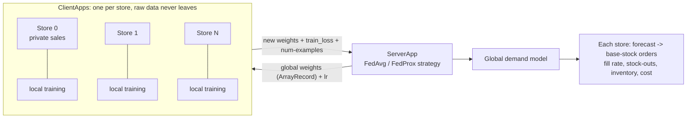
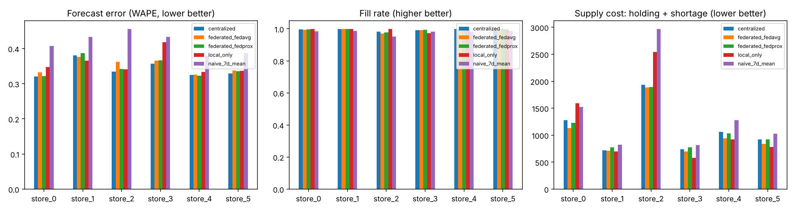
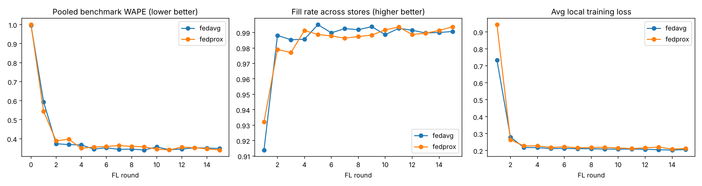
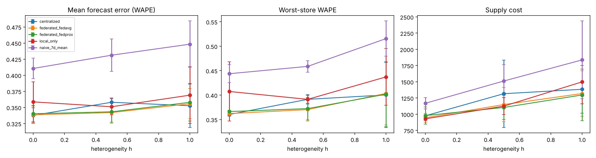

# Federated Demand–Supply Optimization for E-commerce
> Distributed Analytics course project. Several e-commerce stores / warehouses jointly learn a **demand
> forecasting model with federated learning (Flower)** *without sharing raw sales data*, then use the
> forecast to run a **replenishment (inventory) policy**. We measure the effect on both forecast
> accuracy and **supply KPIs** (fill rate, stock-outs, inventory, cost).

**Documents:** [`docs/RESEARCH.md`](docs/RESEARCH.md) literature review and design justification ·
[`docs/EXPLAINER.md`](docs/EXPLAINER.md) code walkthrough, maths, demo script and viva Q&A.

---

## Table of contents
1. [Problem and motivation](#1-problem-and-motivation)
2. [Research background in brief](#2-research-background-in-brief)
3. [System architecture](#3-system-architecture)
4. [Project layout](#4-project-layout)
5. [Data, model, algorithms](#5-data-model-algorithms)
6. [Quick start](#6-quick-start)
7. [Results](#7-results)
8. [Experiments you can run](#8-experiments-you-can-run)
9. [Limitations](#9-limitations)
10. [Extensions](#10-extensions)
11. [Troubleshooting](#11-troubleshooting)
12. [Publish to GitHub](#12-publish-to-github)
13. [References](#13-references)

---

## 1. Problem and motivation

A marketplace or retail group has many stores. Each store sees only its own sales, prices and promotions,
which are commercially sensitive. Each store must order stock *before* demand is known:

* too little stock -> **stock-outs** (lost sales);
* too much stock -> **holding cost** (capital, storage, spoilage).

A better demand forecast lets a store hold less safety stock for the same service level. But each store has
a short local history, and pooling everyone's data is not allowed. **Federated learning** solves this: only model
weights travel, never the sales records.

Research questions this project answers:
1. Does federated training beat what each store can learn alone?
2. How close does it get to pooling all data (centralized)?
3. Does FedProx help as stores become more different (non-IID)?
4. Do forecast gains turn into lower supply cost / higher fill rate?
5. Who benefits, the average store or the worst-off store?

## 2. Research background in brief

Full review with sources: [`docs/RESEARCH.md`](docs/RESEARCH.md).

* **FedAvg** (McMahan et al., 2017): clients train locally, server averages weights by data size. Our baseline.
* **FedProx** (Li et al., 2020): adds a proximal term to client objectives; reported to be more robust than FedAvg on heterogeneous data.
* **Flower** (Beutel et al.): the FL framework used for the whole implementation.
* **FL for demand forecasting** exists in the literature: vertical FL for retail supply chains (Wang et al., 2022),
  blockchain + FedAvg + SecAgg+ + DP for grocery waste reduction (Turazza et al., ISCC 2025), clustered FL for
  heterogeneous retail sales (Long et al., 2025), and a GNN+FL study reporting FL about 4% below centralized.
* **Privacy in production** (course deck, Gboard): secure aggregation, clipping and DP noise, scale. Listed here as extensions.
* **Inventory theory** (Silver, Pyke, Thomas): base-stock policy with safety stock `z·σ·√(L+1)`.

**What this project adds:** a transparent end-to-end pipeline connecting federated forecasting to an explicit inventory
simulation, with controlled heterogeneity, baselines, multi-seed sweeps and per-store reporting.

## 3. System architecture



One round: server broadcasts model -> stores train on local data -> stores return weights + sample counts ->
server averages (weighted) -> stores evaluate on their own held-out *future* days and report forecast + supply KPIs.
A detailed trace is in [`docs/EXPLAINER.md`](docs/EXPLAINER.md#2-what-happens-in-one-round-trace-it-in-the-logs).

## 4. Project layout

```
ecom-fl-demand-supply/
├── ecomfl/
│   ├── data.py          synthetic non-IID multi-store sales generator + features
│   ├── task.py          plain PyTorch: DemandNet, train() (+FedProx term), evaluation
│   ├── inventory.py     base-stock replenishment simulator
│   ├── client_app.py    Flower ClientApp  (@app.train, @app.evaluate)
│   ├── server_app.py    Flower ServerApp  (FedAvg / FedProx, saves model + history)
│   └── config.py        run-config resolution (works for `flwr run` and Python API)
├── scripts/
│   ├── run_simulation.py   run the federation in-process (recommended, no per-run installs)
│   ├── compare.py          naive / local-only / centralized / federated, per store
│   ├── run_sweep.py        heterogeneity x seeds robustness study (mean ± std)
│   ├── plot_training.py    per-round curves
│   └── push_to_github.sh   publish helper
├── tests/test_core.py   5 unit tests
├── docs/                RESEARCH.md, EXPLAINER.md
├── results/             outputs of the runs reported below (models, CSVs, figures)
├── pyproject.toml       Flower app definition + default run-config
├── requirements.txt · Makefile · LICENSE · .github/workflows/ci.yml
```

## 5. Data, model, algorithms

**Data (synthetic, non-IID by design).** 420 days x 8 SKUs per store, 4 categories (electronics, fashion, grocery, home).
Shared across stores: category price elasticity, weekly pattern, promo effect, November electronics peak.
Store-specific (scaled by `heterogeneity` h in [0,1]): size, seasonal phase/amplitude, weekend tilt, promo response,
trend, category mix. Over-dispersed counts. **Temporal split:** first 80% of days train, last 20% test.

**Features (23):** lags 1,2,3,7,14,28 of log(1+sales); rolling means 7/28; planned price ratio; promo flag;
day-of-week; yearly sin/cos; category. **Target:** log(1+sales). **Model:** MLP 23-64-32-1.

**FedAvg:** `w = Σ (n_k/N) w_k`.  **FedProx:** local loss + `(μ/2)‖w − w_global‖²` (`proximal-mu` > 0).

**Replenishment (daily, per SKU):** lead time L=2, z=1.28, `S = (L+1)·forecast + z·σ·√(L+1)`,
`order = max(0, S − inventory position)`; σ from **training** residuals. Cost = 0.05/unit-day held + 1.00/unit lost.

**Metrics:** WAPE = Σ|error|/Σ actual (lower better), fill rate (higher better), average inventory, total cost, worst-store WAPE.

## 6. Quick start

Requirements: Python 3.10+ (tested on 3.12), ~2 GB disk for PyTorch, Linux/macOS (on Windows use WSL).

```bash
git clone https://github.com/<you>/ecom-fl-demand-supply.git
cd ecom-fl-demand-supply
python -m venv .venv && source .venv/bin/activate
pip install -e ".[dev]"            # or: pip install -r requirements.txt

pytest -q                          # 5 tests, ~5 s
```

### Option A (recommended): Python simulation API, ~1–2 min per run on CPU

```bash
export ECOMFL_RESULTS=$PWD/results                      # where model + history are saved
python scripts/run_simulation.py --tag fedavg           # FedAvg, 15 rounds
python scripts/run_simulation.py --tag fedprox --mu 0.1 # FedProx
python scripts/compare.py --fl fedavg fedprox           # per-store table + results/comparison.png
python scripts/plot_training.py fedavg fedprox          # results/training_curves.png
# shortcuts: make test | make run | make fedprox | make compare | make all
```

### Option B: Flower CLI (as in the course tutorial)

```bash
export ECOMFL_RESULTS=$PWD/results
flwr run . --stream
flwr run . --run-config "num-server-rounds=20 proximal-mu=0.1 run-tag=fedprox heterogeneity=0.9" --stream
```
`flwr run` builds an isolated environment and installs the app's dependencies (including PyTorch) on the first run,
so it can take several minutes and needs free disk space. The settings live in `[tool.flwr.app.config]` of
`pyproject.toml`; `num-stores` must equal `options.num-supernodes`.

### What a run looks like

```
[ROUND 1/15]
  configure_train: Sampled 6 nodes (out of 6)
  aggregate_train: Received 6 results and 0 failures
  └──> Aggregated MetricRecord: {'train_loss': 0.647}
  aggregate_evaluate: ... {'eval_wape': 0.431, 'fill_rate': 0.966, 'total_cost': 1275, ...}
```

## 7. Results

All numbers below are produced by the code in this repo (CSV/PNG in `results/`).

### 7.1 Main run: 6 stores, h = 0.7, 15 rounds x 2 local epochs, data seed 42 (single seed)

| Method | WAPE ↓ | Fill rate ↑ | Avg inventory | Supply cost ↓ | Worst-store WAPE ↓ |
|---|---|---|---|---|---|
| Naive 7-day mean | 0.416 | 0.979 | 33.6 | 1406 | 0.456 |
| Local-only | 0.357 | 0.993 | 33.7 | 1186 | 0.418 |
| Federated FedAvg | 0.350 | 0.991 | 26.6 | 1033 | 0.376 |
| Federated FedProx (μ=0.1) | 0.346 | 0.994 | 30.0 | 1104 | 0.387 |
| Centralized (pools raw data) | 0.341 | 0.994 | 30.5 | 1108 | 0.380 |




### 7.2 Robustness sweep: h ∈ {0, 0.5, 1}, 2 data seeds, 10 rounds (`results/sweep_summary.csv`)

Mean ± std of the store-average WAPE across seeds; cost is the mean total cost; worst = highest single-store WAPE.

| h | Method | WAPE | Cost | Worst-store WAPE |
|---|---|---|---|---|
| 0.0 | Naive | 0.411 ± 0.016 | 1169 | 0.444 |
| 0.0 | Local-only | 0.359 ± 0.031 | **929** | 0.407 |
| 0.0 | FedAvg | 0.339 ± 0.014 | 946 | 0.362 |
| 0.0 | FedProx | 0.340 ± 0.013 | 980 | 0.366 |
| 0.0 | Centralized | 0.338 ± 0.012 | 976 | 0.360 |
| 0.5 | Naive | 0.431 ± 0.025 | 1512 | 0.459 |
| 0.5 | Local-only | 0.351 ± 0.013 | 1125 | 0.391 |
| 0.5 | FedAvg | 0.342 ± 0.017 | 1149 | 0.370 |
| 0.5 | FedProx | 0.343 ± 0.016 | **1105** | 0.372 |
| 0.5 | Centralized | 0.358 ± 0.007 | 1317 | 0.391 |
| 1.0 | Naive | 0.448 ± 0.036 | 1838 | 0.516 |
| 1.0 | Local-only | 0.369 ± 0.044 | 1499 | 0.437 |
| 1.0 | FedAvg | 0.356 ± 0.023 | 1319 | 0.403 |
| 1.0 | FedProx | 0.358 ± 0.029 | **1297** | 0.402 |
| 1.0 | Centralized | 0.353 ± 0.034 | 1385 | 0.400 |



### 7.3 What the evidence supports, and what it does not

* **Learned models clearly beat the naive baseline** at every heterogeneity level (roughly 13–21% lower WAPE and 13–29% lower cost, depending on method and h).
* **Federated vs local-only:** federated has lower mean WAPE and a lower worst-store WAPE at every h, and at h = 1.0 about
  12% lower cost (1319 vs 1499). But the WAPE gaps (0.2–1.3 points) are **smaller than the seed-to-seed standard deviation**
  (1.3–4.4 points). With only 2 seeds this is a consistent direction, **not a statistically established win**.
* **Cost is not a monotone function of WAPE.** At h = 0 local-only has the *lowest* cost (929) despite worse WAPE, because cost depends on
  bias and errors on peak days, not only average error.
* **Federated ≈ centralized.** At h = 0 and 1.0 they are within noise. At h = 0.5 federated is *better* than centralized: centralized is
  not a strict upper bound here (one fixed-size MLP, same epoch budget, no store identifier). We have not tested the reason.
* **FedProx ≈ FedAvg.** No evidence that μ = 0.1 helps in this setup; its differences are within noise.
* To firm these up: run ≥ 5 seeds (`python scripts/run_sweep.py --seeds 1 2 3 4 5`) and tune μ.

## 8. Experiments you can run

| Question | Command / knob |
|---|---|
| Effect of heterogeneity | `python scripts/run_sweep.py --het 0 0.3 0.6 1.0 --seeds 1 2 3` |
| Effect of μ (FedProx) | `python scripts/run_simulation.py --tag p1 --mu 0.01` ... `--mu 1.0` |
| Partial participation | `flwr run . --run-config "fraction-train=0.5"` |
| Communication vs local work | `--local-epochs 1/2/5` and `--rounds` |
| More stores | `--stores 20` (and `options.num-supernodes` if using `flwr run`) |
| Service level / cost trade-off | change `z`, `HOLD_COST`, `SHORTAGE_COST` in `ecomfl/inventory.py` |

## 9. Limitations

* **Synthetic data**: conclusions concern the method, not a real retailer. Replace `load_store()` in `ecomfl/data.py` with a loader that returns the same `StoreData` to use M5, Rossmann, Olist, etc.
* **Simulation only**: all nodes run on one machine; the server-side pooled benchmark would not exist in production.
* **No formal privacy guarantee**: weights can leak information; no secure aggregation or DP in the baseline.
* **Single-echelon inventory model**, fixed lead time, no capacity or order cost.
* **One-step-ahead forecast** with true lagged sales; multi-step planning needs multi-horizon models.
* **Statistical power**: 1 seed (main run) and 2 seeds (sweep) per setting; see §7.3.
* **Verified in:** Python 3.12, Flower 1.42.0, PyTorch 2.15 on Linux (CPU). Unit tests, the Python-API path, and a from-scratch clone were run. **Not verified here:** `flwr run .` end to end (the isolated per-run install exceeded my sandbox's disk), the GitHub Actions workflow, Windows/macOS.

## 10. Extensions

Differential privacy (clipping + noise), secure aggregation, clustered FL (Long et al.), local personalization, GRU/Transformer models,
real datasets, (s,S) / multi-echelon policies. Hook points are listed in [`docs/EXPLAINER.md`](docs/EXPLAINER.md#7-extensions-pick-one-for-future-work-or-extra-credit).

## 11. Troubleshooting

| Symptom | Fix |
|---|---|
| `ActorPool is empty` | Ray found too few CPUs. `scripts/run_simulation.py` already sets 1 CPU per client; for `flwr run` keep `options.backend.client-resources.num-cpus = 1` in `pyproject.toml`. |
| `externally-managed-environment` (PEP 668) | Use a virtual environment (`python -m venv .venv`). |
| `flwr run` is slow the first time | It installs dependencies into an isolated env; use Option A. |
| `No space left on device` | PyTorch + CUDA wheels are large; install a CPU build: `pip install torch --index-url https://download.pytorch.org/whl/cpu`. |
| Model/history not saved where expected | Set `ECOMFL_RESULTS=$PWD/results` before running. |
| `ModuleNotFoundError: ecomfl` | Run scripts from the repo root, or `pip install -e .`. |
| Deprecation warning for `run_simulation` or `options.` | Expected for this Flower version; it still runs. |

## 12. Publish to GitHub

```bash
# 1) create an EMPTY repo on github.com (no README/license), then:
cd ecom-fl-demand-supply
git init && git add -A && git commit -m "Federated demand-supply with Flower"
git branch -M main
git remote add origin https://github.com/<you>/ecom-fl-demand-supply.git
git push -u origin main
# or: ./scripts/push_to_github.sh https://github.com/<you>/ecom-fl-demand-supply.git
```
Before pushing: set `publisher` in `pyproject.toml` and your name in `LICENSE`.

## 13. References

Full list in [`docs/RESEARCH.md`](docs/RESEARCH.md#5-references-bibtex-ready-identifiers). Key ones:
McMahan et al. 2017 (arXiv:1602.05629) · Li et al. 2020 (arXiv:1812.06127) · Beutel et al. (arXiv:2007.14390) ·
Kairouz et al. 2021 (arXiv:1912.04977) · Wang et al. 2022 · Turazza et al. 2025 (arXiv:2602.04384) · Long et al. (arXiv:2503.12220) ·
Xu et al. 2023, Gboard DP (arXiv:2305.18465) · Bonawitz et al. 2017 · Makridakis et al. 2022 · Silver, Pyke, Thomas 2017.
